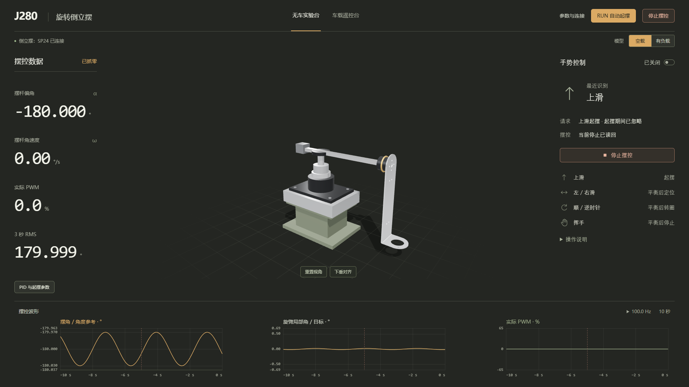
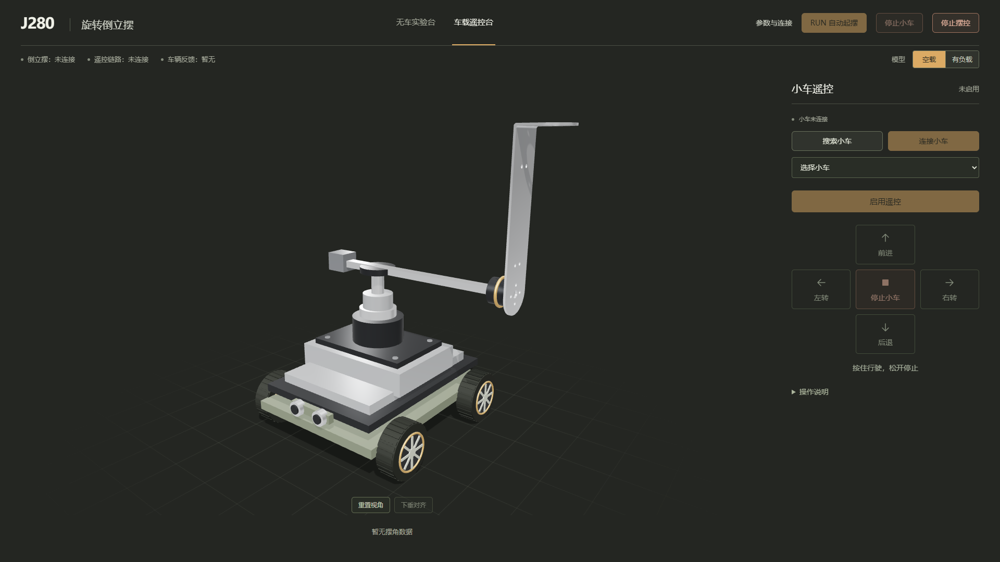

# 2026-10-16 已确认界面

用户确认本版 UI 设计可作为后续基准。布局与字体取舍见根目录 [DESIGN.md](../../../DESIGN.md) 第10节。

两张图均在 1920×1080 下使用明确的离线 API/WS fixture 截取。实验台曲线、读数及连接状态为示例数据，车载图为未连接空态；这些图片只记录界面，不代表实机验收。

## 无车实验台

## 车载遥控台

保持当前配色、主次关系、跨列模型、手势区等线与简洁字阶。文字不增加黑色块状衬底或模糊阴影；详细规则按需展开，当前错误、独立停止和真实请求/动作状态保留。
